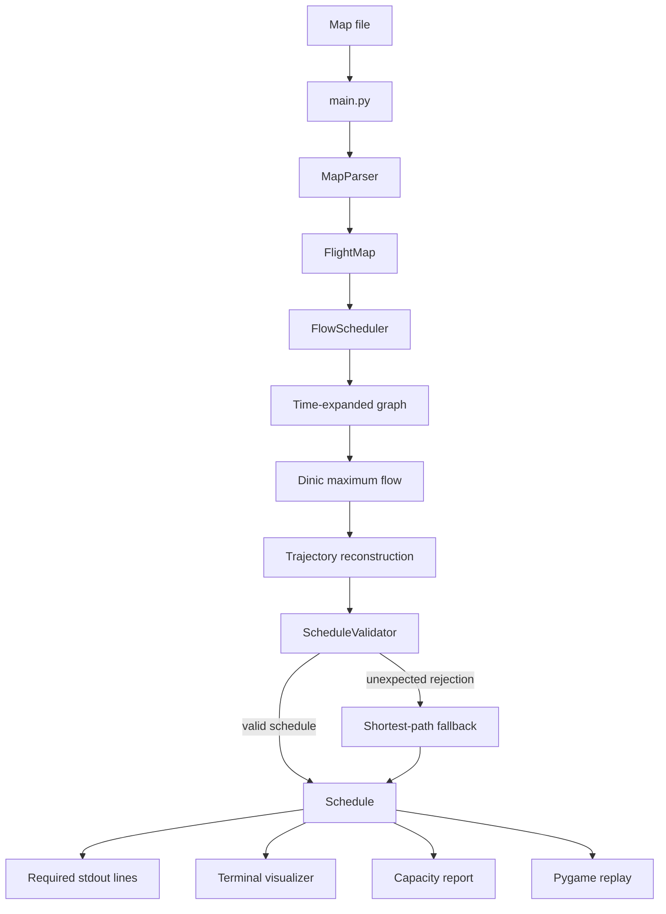
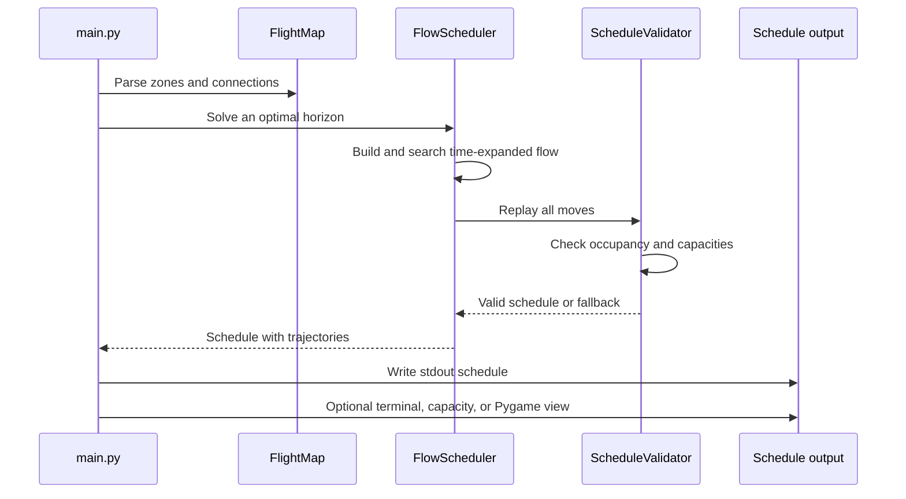

*This project has been created as part of the 42 curriculum by mirelsan.*

# Fly-in

## Description

**Fly-in** is a drone routing and simulation project. Given a network of
connected zones, a fleet of drones must travel from a unique start hub to a
unique end hub in the smallest possible number of simulation turns while
respecting every occupancy, connection-capacity and zone-type rule.

The project includes:

- a strict parser for the Fly-in map format;
- an object-oriented graph model;
- an optimal scheduler based on a time-expanded maximum-flow network;
- a turn-by-turn simulation engine;
- a validator that replays the generated schedule and checks every rule;
- a coloured terminal visualiser;
- the exact required textual output format;
- tests covering the shipped maps and many parser/simulation edge cases.

The implementation is written in Python 3.10+ and uses only the standard
library at runtime. It is fully typed (`mypy`) and `flake8` clean.

## Features

- Handles `normal`, `priority`, `restricted` and `blocked` zones.
- Handles `max_drones` on zones and `max_link_capacity` on connections.
- Handles the special unlimited capacity of the start and end hubs.
- Supports multi-turn crossings of restricted connections.
- Models simultaneous movement, including the rule that a space vacated
  during a turn is immediately reusable during that same turn.
- Distributes drones across several routes when that improves throughput.
- Detects disconnected graphs and reports a clear error instead of crashing.
- Produces a valid schedule for every solvable map.
- Reaches the reference optimum on all maps shipped with the subject,
  including the optional **The Impossible Dream** challenger map in **43
  turns**.

## Instructions

### Requirements

- Python **3.10 or later**
- `flake8`, `mypy` and `pytest` for development checks

The simulation itself has no third-party runtime dependency.

### Installation

```sh
make install
```

This installs the development tools listed in `requirements.txt`. It is
recommended to run the project inside a virtual environment:

```sh
python3 -m venv .venv
. .venv/bin/activate
make install
```

### Running the simulation

```sh
python3 main.py <map_file>
```

or, through the Makefile:

```sh
make run MAP=maps/easy/01_linear_path.txt
```

Examples:

```sh
python3 main.py maps/easy/02_simple_fork.txt
python3 main.py maps/hard/03_ultimate_challenge.txt --visual
python3 main.py maps/challenger/01_the_impossible_dream.txt --stats
python3 main.py maps/easy/01_linear_path.txt --capacity-info --pygame
```

The required simulation lines are written to **stdout**. Optional visualisations
are printed separately, so stdout always stays in the exact submission format.

### Pygame visualisation

Install the Python dependency and open the interactive replay window:

```sh
python3 -m pip install pygame
python3 main.py maps/easy/01_linear_path.txt --pygame
```

Use `SPACE` to play or pause and the arrow keys to move between turns. This mode
uses only Python and the Pygame library; it does not require a browser.

#### Passo a passo: executar a visualização Pygame

1. Entre na pasta do projeto:

```sh
cd 06_Fly-in
```

2. Instale Python 3.12 e crie um ambiente virtual:

```sh
python3.12 -m venv .venv
```

3. Ative o ambiente virtual:

```sh
source .venv/bin/activate
```

4. Instale o Pygame:

```sh
python -m pip install pygame
```

5. Execute o replay Pygame com um mapa:

```sh
python main.py maps/easy/01_linear_path.txt --pygame
```

Para testar o mapa desafio:

```sh
python main.py maps/challenger/01_the_impossible_dream.txt --pygame
```

No replay, use `SPACE` para reproduzir ou pausar, `←` para voltar um turno e
`→` para avançar um turno.

For the compact ANSI terminal visualisation, use `--visual`. It is written to
`stderr`, so normal simulation output remains unchanged:

```sh
python3 main.py maps/hard/03_ultimate_challenge.txt --visual
```

### Command-line options

| Option | Meaning |
| --- | --- |
| `--visual` / `--no-visual` | Force the turn-by-turn visualiser on or off. By default it is enabled when stderr is a terminal. |
| `--color` / `--no-color` | Force ANSI colours on or off. By default colours are enabled when stdout is a terminal. |
| `--stats` | Print a short summary (fleet size, turns, lower bound) to stderr. |
| `--capacity-info` | Print zone occupancy and connection capacity use at each turn. |
| `--pygame` | Open the Python/Pygame turn-by-turn replay window. |
| `--debug` | Show the full traceback if an unexpected error occurs. |

### Makefile targets

| Target | Action |
| --- | --- |
| `install` | Install development dependencies. |
| `run` | Run the simulation (`MAP=...` selects the map). |
| `debug` | Run the simulation under `pdb`. |
| `clean` | Remove Python caches and temporary files. |
| `lint` | Run `flake8 .` and the mandatory `mypy` command. |
| `lint-strict` | Run `flake8 .` and `mypy . --strict`. |
| `test` | Run the pytest suite. |

The mandatory lint command is:

```sh
flake8 .
mypy . --warn-return-any --warn-unused-ignores --ignore-missing-imports \
    --disallow-untyped-defs --check-untyped-defs
```

## Code flow

The following diagram shows the complete execution path, from reading a map
to producing both the required text schedule and optional visual feedback.



Each turn is replayed independently from the schedule. The normal route
shows drones entering one zone per turn, while a restricted route reserves a
connection and reaches its destination two turns later.



## Project structure

```text
.
├── Makefile
├── README.md
├── main.py                 # CLI entry point
├── mypy.ini                # mypy configuration
├── requirements.txt
├── flyin/
│   ├── __init__.py
│   ├── colors.py           # ANSI colour palette
│   ├── errors.py           # expected exception hierarchy
│   ├── flow.py             # Dinic maximum-flow implementation
│   ├── models.py           # Zone, Connection and FlightMap
│   ├── parser.py           # strict map parser
│   ├── schedule.py         # Move, Trajectory and Schedule
│   ├── scheduler.py        # time-expanded flow scheduler
│   ├── pygame_visualizer.py # interactive Pygame replay
│   ├── validator.py        # rule-by-rule schedule replay
│   └── visualizer.py       # coloured terminal visualiser
├── maps/
│   ├── easy/
│   ├── medium/
│   ├── hard/
│   └── challenger/
└── tests/
    └── test_flyin.py
```

## Map format

The parser accepts the format described in the subject:

```text
nb_drones: 5

start_hub: start 0 0 [color=green]
end_hub: goal 10 10 [color=yellow]
hub: roof1 3 4 [zone=restricted color=red]
hub: roof2 6 2 [zone=normal color=blue]
hub: corridorA 4 3 [zone=priority color=green max_drones=2]
hub: tunnelB 7 4 [zone=normal color=red]
hub: obstacleX 5 5 [zone=blocked color=gray]
connection: start-roof1
connection: start-corridorA
connection: roof1-roof2
connection: roof2-goal
connection: corridorA-tunnelB [max_link_capacity=2]
connection: tunnelB-goal
```

The parser validates:

- exactly one `nb_drones`, declared before zones and connections;
- exactly one start hub and one end hub, with different names;
- unique zone names, integer coordinates and no dashes/spaces in names;
- valid zone types and strictly positive capacities;
- metadata syntax and known metadata keys;
- connections that reference already-defined zones;
- duplicate connections in either direction (`a-b` and `b-a`);
- malformed lines, comments, empty files and missing declarations.

Every error is reported with the line number and the cause. A syntactically
valid but disconnected map raises a clear `UnsolvableError` instead of
hanging or crashing.

## Algorithm choices and implementation strategy

### 1. Object-oriented graph model

`FlightMap` owns `Zone` and `Connection` objects and builds adjacency lists
once. A `Zone` knows its type, colour, coordinates, capacity and movement
cost. A `Connection` knows both endpoints and its shared link capacity.
`ZoneType` is an enum, so invalid types cannot silently propagate.

### 2. Shortest-path bounds

A Dijkstra search computes the cheapest start-to-end route. The cost of an
edge is the movement cost of its **destination** zone:

- `normal` and `priority`: 1 turn;
- `restricted`: 2 turns;
- `blocked`: never entered.

Ties prefer priority zones. The resulting cost `L` is a lower bound on the
makespan. A simple pipeline of all drones along that route gives the valid
upper bound `L + N - 1`, where `N` is the fleet size.

### 3. Time-expanded maximum flow

The core scheduler builds a time-expanded network for a fixed horizon `T`:

- each zone has an `in` and an `out` node for every turn;
- an edge between them enforces `max_drones`;
- waiting edges connect `out(zone, t)` to `in(zone, t + 1)`;
- a movement edge jumps from the departure turn to the arrival turn,
  using cost 1 for normal/priority destinations and cost 2 for restricted
  destinations;
- the start and end hubs receive unlimited capacity;
- the end hub is absorbing: once a drone reaches it, the only outgoing
  edge leads to the sink;
- a small shared-capacity gadget per connection and departure turn enforces
  `max_link_capacity` across **both** directions simultaneously.

A super-source injects `N` units of flow at the start hub at turn 0, and a
super-sink collects flow from the end hub. An integral flow of value `N`
is exactly a valid schedule. Because all capacities are integers, Dinic's
algorithm returns an integral flow.

### 4. Optimal horizon

Feasibility is monotone in `T`: if all drones can arrive by `T`, they can
also arrive by `T + 1` by waiting. The scheduler therefore binary-searches
the smallest feasible horizon between the shortest-path lower bound and the
pipeline upper bound. On the shipped maps this finds the exact reference
optimum.

### 5. Flow decomposition and trajectory construction

The integral flow is decomposed into `N` source-to-sink paths. Each path is
converted into a `Trajectory` by reading the time-expanded node sequence:

- a normal move produces `D<id>-<zone>` on the departure turn;
- a restricted move produces `D<id>-<connection>` on the departure turn and
  `D<id>-<zone>` on the arrival turn;
- waiting produces no visible move.

### 6. Independent validation and safe fallback

Before a schedule is returned, `ScheduleValidator` replays it from turn 1
and checks:

- adjacency and blocked zones;
- simultaneous movement and the vacate-then-enter rule;
- zone capacities after every turn;
- shared connection capacity per departure turn;
- restricted crossings arriving exactly on the next turn;
- every drone being delivered at the end.

If the optimal flow schedule were ever rejected by the validator, the
scheduler falls back to a guaranteed-valid pipeline along the shortest path.
This makes correctness independent of the optimisation model.

### Complexity

Let `V` be the number of zones, `E` the number of connections, `N` the
number of drones and `T` the chosen horizon. The time-expanded graph has
`O(T · (V + E))` nodes and edges, and memory usage is also
`O(T · (V + E))`. Dinic's algorithm is polynomial on that graph; the binary
search adds a logarithmic factor in the horizon range. The horizon itself
is at most `L + N - 1`, so the method is pseudo-polynomial in the fleet
size. For the maps shipped with the subject the graphs are small and the
solver runs in well under a second per map. To keep runtime bounded for
very large fleets, the scheduler automatically switches to the
guaranteed-valid pipeline fallback above 60 drones; the optimal flow solver
is used for typical and benchmark fleet sizes.

## Visual representation

The visualiser is a coloured terminal view written to stderr. For every
turn it prints:

- the turn number;
- the visible drone movements, coloured with the destination zone colour;
- the occupancy of every non-empty zone;
- the drones currently in flight on restricted connections.

Example:

```text
--- Turn 3 ---
  D1-loop_b-exit_point D2-loop_b D3-loop_a
  Zones: loop_a(1) loop_b(2) start(3)
  In flight: loop_b-exit_point (loop_b->exit_point)
```

The colours come directly from the map metadata (`color=...`). Common
names such as `red`, `green`, `blue`, `orange`, `purple`, `gold` and
`crimson` have dedicated ANSI codes; unknown colour names fall back to the
terminal default. Colours are automatically disabled when the output is
not a terminal, and can be forced with `--color` or `--no-color`.

The visualisation makes it easy to understand:

- which route each drone chose;
- where queues form because of zone or link capacities;
- when a drone is in flight on a restricted connection;
- how the fleet is distributed across parallel paths.

## Example input and expected output

Input (`maps/easy/01_linear_path.txt`):

```text
nb_drones: 2

start_hub: start 0 0 [color=green]
hub: waypoint1 1 0 [color=blue]
hub: waypoint2 2 0 [color=blue]
end_hub: goal 3 0 [color=red]

connection: start-waypoint1
connection: waypoint1-waypoint2
connection: waypoint2-goal
```

Command:

```sh
python3 main.py maps/easy/01_linear_path.txt --no-visual --no-color
```

Expected output:

```text
D1-waypoint1
D1-waypoint2 D2-waypoint1
D1-goal D2-waypoint2
D2-goal
```

## Benchmark results

The following results were produced by the scheduler on the maps shipped
with the subject. Every result matches the reference optimum.

| Category | Map | Drones | Turns | Reference |
| --- | --- | ---: | ---: | ---: |
| Easy | Linear path | 2 | 4 | 4 |
| Easy | Simple fork | 4 | 4 | 4 |
| Easy | Basic capacity | 4 | 4 | 4 |
| Medium | Dead end trap | 5 | 8 | 8 |
| Medium | Circular loop | 6 | 10 | 10 |
| Medium | Priority puzzle | 5 | 6 | 6 |
| Hard | Maze nightmare | 8 | 13 | 13 |
| Hard | Capacity hell | 12 | 16 | 16 |
| Hard | Ultimate challenge | 15 | 26 | 26 |
| Challenger | The Impossible Dream | 25 | **43** | 43 |

## Bonus

The optional challenger map **The Impossible Dream** is solved in exactly
**43 turns**, the reference optimum. The solution uses the early
`maze_trap_a2 -> micro_gate1` shortcut, the `overflow_hell`/`conv_restricted`
corridor, and a one-drone-per-turn pipeline through the final capacity-1
chain. This matches the subject's analysis: entry latency 19 plus one turn
for each of the remaining 24 drones.

Run it with:

```sh
python3 main.py maps/challenger/01_the_impossible_dream.txt --stats
```

## Testing

The project ships with a pytest suite covering:

- all ten benchmark maps and their exact turn counts;
- the required output format;
- restricted-connection transit announcements;
- invalid zone types, duplicate connections and non-positive capacities;
- disconnected maps;
- blocked-zone avoidance;
- metadata written in arbitrary order.

Run it with:

```sh
make test
```

The suite is not required for the peer review, but it is useful for
regression checking and for demonstrating the edge cases handled by the
parser and the simulator.

## Resources

### Classic references

- Python 3 documentation: <https://docs.python.org/3/>
- PEP 257 — Docstring Conventions:
  <https://peps.python.org/pep-0257/>
- `flake8` documentation: <https://flake8.pycqa.org/>
- `mypy` documentation: <https://mypy.readthedocs.io/>
- Thomas H. Cormen, Charles E. Leiserson, Ronald L. Rivest and Clifford
  Stein, *Introduction to Algorithms* — maximum flow and Dinic's algorithm.
- Yefim Dinitz, "Algorithm for Solution of a Problem of Maximum Flow in a
  Network with Power Estimation", *Soviet Mathematics Doklady*, 1970.
- Time-expanded networks and quickest-flow models:
  <https://cp-algorithms.com/graph/dinic.html>
- Ford–Fulkerson and flow-decomposition background:
  <https://en.wikipedia.org/wiki/Maximum_flow_problem>

### How AI was used

AI was used as a pair-programming and review assistant during this project.
More specifically, it helped with:

- brainstorming the time-expanded maximum-flow formulation and the
  shared-capacity connection gadget;
- reviewing the parser's error handling and edge cases;
- checking type annotations and the `mypy`/`flake8` configuration;
- drafting and editing this README, including the algorithm explanation and
  the benchmark table.

Every AI-generated suggestion was read, tested against the shipped maps,
and validated by the independent `ScheduleValidator`. The final code is
fully understood and maintained by the author; no generated code was
accepted without verification.

## Author

- **mirelsan** — 42 curriculum project
