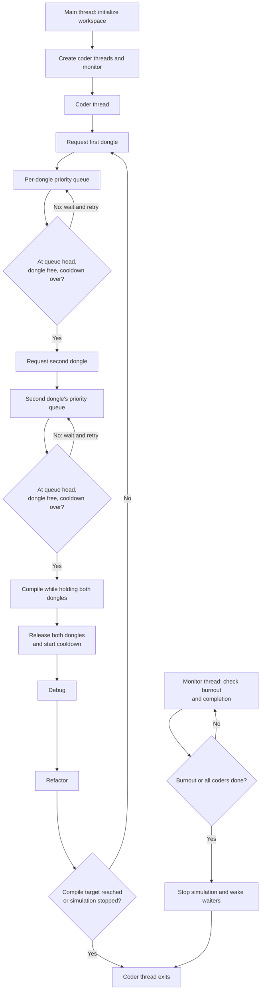

*This project has been created as part
of the 42 curriculum by mirelapitt.*

# Codexion

## Description (Descrição)

Codexion is a C concurrency simulation using POSIX threads. Each coder runs in
its own thread and must acquire two shared dongles to compile. They then debug
and refactor before starting another cycle. A monitor tracks the burnout
deadline and stops the simulation when a coder exceeds it or when every coder
reaches the requested number of compilations.

Each dongle has its own request queue. The selected scheduler determines which
request at the head may use that dongle:

- `fifo`: serves the oldest request first.
- `edf`: serves the request with the earliest burnout deadline first
  (Earliest Deadline First); ties are resolved by arrival order.
- `lifo`: serves the newest request first (Last In, First Out).

## Visual Overview



Each dongle arbitrates its own waiting requests using the selected scheduler.
The monitor runs alongside the coder threads and can stop the simulation
independently when a burnout deadline is reached or all coders finish.

## Instructions (Instruções)

### Build

From the `08_Codexion` directory, run:

```sh
make
```

The output executable is named `codexion`. Use `make clean` to remove object
files, `make fclean` to remove the objects and executable, and `make re` to
rebuild everything.

### Run

```sh
./codexion <coders> <burnout_ms> <compile_ms> <debug_ms> \
  <refactor_ms> <compiles_required> <dongle_cooldown_ms> <fifo|edf|lifo>
```

Arguments, in order: number of coders, time to burnout, compile time, debug
time, refactor time, required number of compilations, dongle cooldown, and
scheduler. Times are in milliseconds. The required number of compilations must
be at least `1`.

Examples:

```sh
./codexion 1 800 200 200 200 10 0 fifo
./codexion 5 2000 200 200 200 10 0 fifo
./codexion 5 3000 200 200 200 10 800 fifo
./codexion 5 3000 200 200 200 10 800 lifo
```

The single-coder case should end in burnout: only one dongle is available, but
compilation requires two distinct dongles. The final two commands use identical
arguments to compare FIFO and LIFO under contention. Actual timing and queue
order can vary with operating-system scheduling. In particular, LIFO can
postpone older requests when newer requests keep arriving.

## Thread Synchronization Mechanisms (Mecanismos de sincronização de threads)

- `pthread_create` creates one thread per coder and a monitor thread; all are
  joined with `pthread_join`.
- Each dongle has a mutex protecting its state, cooldown, sequence counter, and
  request queue.
- A condition variable per dongle lets threads wait while the dongle is busy
  or another request has priority. The conditions are rechecked in a loop
  after each wake-up.
- A mutex per coder protects its compilation count and last compilation time.
- Separate mutexes protect terminal output and the simulation's stop state.

Adjacent coders acquire their two dongles in opposite orders, reducing the
risk of circular wait. A dongle becomes available again only after its
cooldown has elapsed.

## Deadlock and Blocking Cases (Casos de bloqueio tratados)

- **Resource deadlock:** acquisition order alternates between coders. A
  single coder cannot compile with only one dongle, so the monitor eventually
  ends that simulation after burnout.
- **Concurrent access to one dongle:** its mutex protects both the reservation
  and queue, preventing two threads from using it at the same time.
- **Waiting for priority or cooldown:** threads wait on the condition variable
  or until the cooldown expires, then recheck the conditions before proceeding.
- **Monitor/coder data races:** each coder's progress and the simulation stop
  state are read and written under their respective mutexes.
- **Interleaved log lines:** each message is printed while holding the log
  mutex.
- **Shutdown while waiting:** the monitor broadcasts on the dongle condition
  variables to wake blocked threads; cleanup happens only after the threads
  have been joined.

For LIFO, each request's sequence number is negated so that the min-priority
heap places the newest request at the head. Queues are independent per dongle,
so LIFO may postpone older requests during sustained contention.

## Resources (Recursos)

- `Codexion_subject.pdf`, included with the project: requirements, arguments,
  and expected behavior.
- `Projetos_Codexion_Intra.pdf`, included with the project: evaluation criteria,
  test cases, and the FIFO-to-LIFO recoding exercise.
- POSIX Threads reference:
  <https://man7.org/linux/man-pages/man7/pthreads.7.html>
- `pthread_mutex_lock` reference:
  <https://man7.org/linux/man-pages/man3/pthread_mutex_lock.3p.html>
- `pthread_cond_wait` reference:
  <https://man7.org/linux/man-pages/man3/pthread_cond_wait.3p.html>

### AI Usage

AI was used in this task to help review the queue policy, implement LIFO in the
scheduler logic, identify an unsynchronized compilation-counter read, and
prepare the README, teaching guide, and tests. The changes were compiled and
checked against the scenarios below. The author should understand and review
the code and results before the evaluation.

### Validation

The following scenarios were run:

- A single coder with an 800 ms burnout deadline burned out without compiling.
- The 5-coder FIFO and EDF reference cases completed the requested 10 and 7
  compilations respectively.
- The 5-coder, 500 ms deadline case burned out near its deadline.
- The 400 ms FIFO cooldown case completed all requested compilations.
- With a 3000 ms burnout deadline and an 800 ms cooldown, the FIFO, EDF, and
  LIFO runs observed here burned out before every coder completed 10
  compilations. This is a tight workload/deadline combination, not a guarantee
  of completion.
- An invalid scheduler name was rejected.
- Helgrind and Valgrind completed the smaller LIFO and FIFO runs without
  reporting errors or memory leaks.
